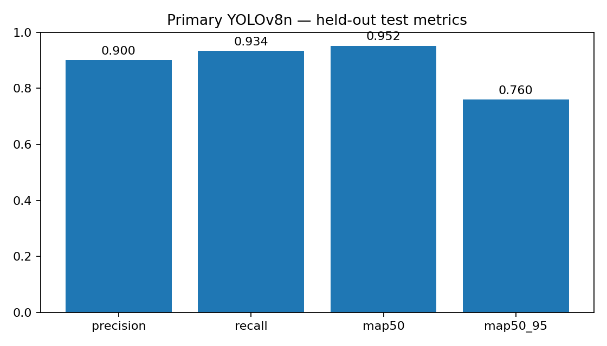
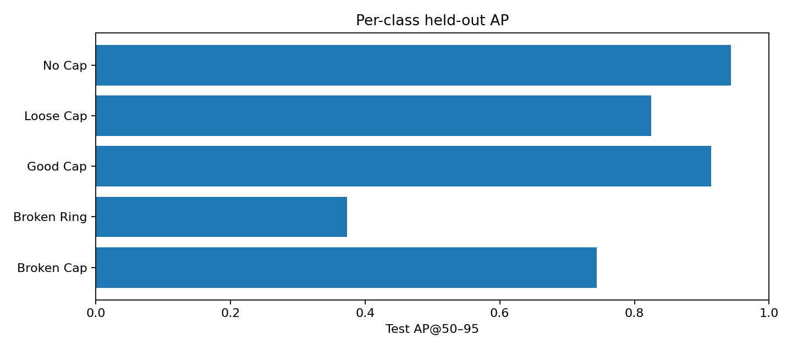
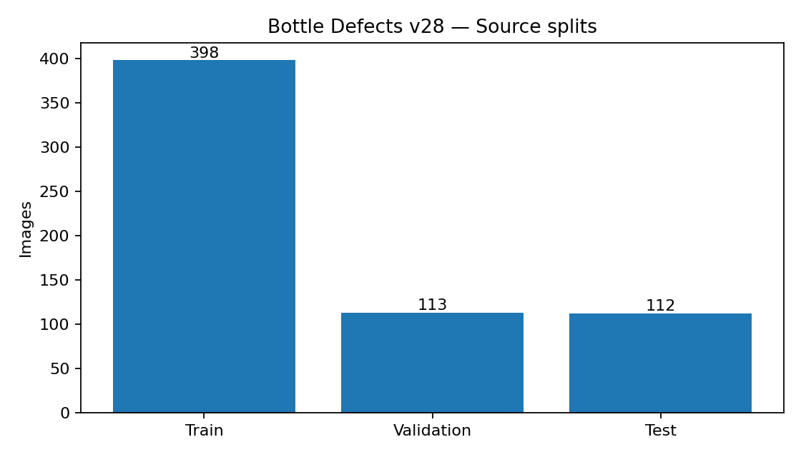
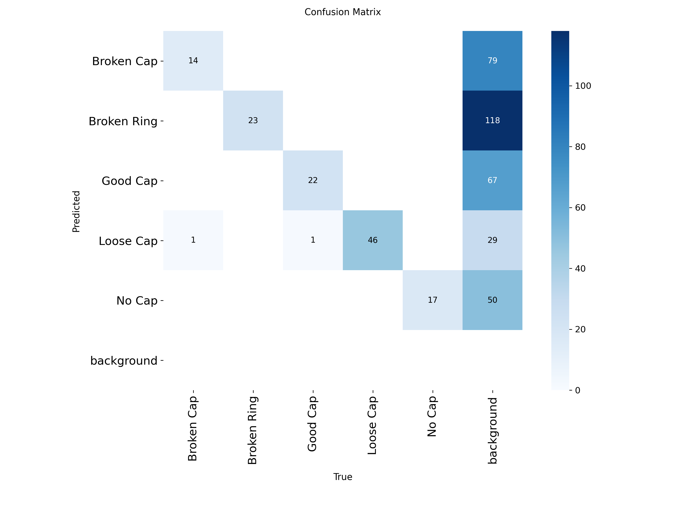

# BottleCap Checker

**Day 23 / 100 • Industrial visual inspection • Research prototype • YOLOv8n + FastAPI + React**

[](https://github.com/MENSTRUE/BottleCap-Checker)   

**BottleCap Checker** is an end-to-end, evidence-first bottle-cap visual inspection research project. It connects a five-class YOLOv8n detector trained on the *Bottle Defects v28* primary dataset to a local FastAPI inference API and a React/TypeScript inspection dashboard. It detects and localizes research-defined cap conditions, **not certified factory acceptance decisions**.

**Repository:** https://github.com/MENSTRUE/BottleCap-Checker  
**Notebook:** [`notebooks/bottlecap-checker.ipynb`](notebooks/bottlecap-checker.ipynb)  
**Primary evaluation:** [`reports/final_summary.json`](reports/final_summary.json), [`reports/primary_heldout_metrics.json`](reports/primary_heldout_metrics.json)  
**Documentation:** [Indonesia](docs/id/README.md) · [English technical guide](docs/en/README.md) · [Research methodology](docs/METHODOLOGY.md) · [Testing](docs/TESTING.md) · [Deployment](docs/DEPLOYMENT.md) · [Release checklist](docs/RELEASE_CHECKLIST.md)

> **Evidence policy:** This README reports recorded Kaggle evaluation results, local API tests, and the explicitly supplied browser smoke-test screenshot as *different kinds of evidence*. It does not substitute an attractive demo for a representative benchmark or infer accuracy from one prediction.

## 1. The problem and decision boundary

Bottle-cap inspection matters for packaging quality. Caps may be visibly damaged, sealing rings may be broken, caps may be loose, or an expected cap may be missing. Manual review is a practical bottleneck; computer vision can highlight candidate regions for an operator. Detection alone does **not** establish seal integrity, product safety, regulatory compliance, or a line-specific reject criterion.

This MVP answers: **where does the trained detector see a cap-related condition, what label does it assign, and with what confidence?** It does not answer: **is the entire bottle safe to ship?** A human reviewer remains responsible for that decision.

### Before → Now → Next

| Phase | State | Evidence / concrete meaning |
|---|---|---|
| **Before** | Two candidate packaging datasets, no integrated application | Dataset sources and ontologies inspected independently. |
| **Now — research** | Primary dataset audited, YOLOv8n trained, checkpoint selected on validation, held-out test recorded | `reports/primary_audit.json`, `reports/primary_family_audit.json`, `reports/training_info.json`, `reports/primary_heldout_metrics.json`. |
| **Now — artifact** | `.pt` best and last checkpoints, exported ONNX available | `models/bottlecap_primary_best.pt`, `models/bottlecap_primary_last.pt`, `models/bottlecap_primary_best.onnx`; export audit in `reports/onnx_export_audit.json`. |
| **Now — application** | FastAPI and React integrated; a local Loose Cap prediction demonstrated | `backend/`, `frontend/`, and `assets/screenshots/Screenshot 2026-10-28 184458.png`. |
| **Next — validation** | Expand true held-out functional checks by class; log false positives and missed detections | See `docs/TESTING.md` and `docs/RELEASE_CHECKLIST.md`. |
| **Next — engineering** | CI, reproducible version pinning, monitoring, access control, benchmark on external production-like samples | Roadmap below; not claimed implemented. |

## 2. Demo and visual evidence

### Real local application screenshot


*Local smoke test: one bounding-box prediction labelled **Loose Cap** at approximately 89.5% confidence, with 59.1 ms displayed inference time. This is **one browser interaction**, not a measured latency distribution or evidence of model accuracy across unseen production data.*

### Research visualizations (generated by training notebook)

| Held-out aggregate performance | Per-class held-out AP50–95 |
|---|---|
|  |  |

| Dataset distribution | Test confusion matrix |
|---|---|
|  |  |

Other original artifacts: [`train_results.png`](assets/plots/train_results.png), [`primary_gt_examples.png`](assets/plots/primary_gt_examples.png), [`train_labels.jpg`](assets/plots/train_labels.jpg), plus normalized and per-split confusion matrices. **Do not confuse training curves or demo screenshots with held-out metrics.**

## 3. Task, five-class contract and intended use

The primary experiment is **object detection**, not classification of a whole package. One image may contain zero, one, or several predicted boxes. The exact checkpoint class index order is an immutable runtime contract:

| Index | Original class | Intended interpretation | Important caution |
|---:|---|---|---|
| 0 | `Broken Cap` | Visual pattern annotated as cap damage | Appearance alone may not establish leak risk. |
| 1 | `Broken Ring` | Broken tamper ring / band annotation | Small structures are challenging; weakest AP50–95 on held-out test. |
| 2 | `Good Cap` | Region annotated as visually good cap | **Not** approval of the complete package. |
| 3 | `Loose Cap` | Cap appearance annotated as loose | A photo cannot directly measure torque or seal tightness. |
| 4 | `No Cap` | Annotated missing-cap condition | No predicted box does not imply a cap is present. |

The backend rejects a checkpoint whose `task` or `names` differs from this contract. Do not rename, merge, or silently reorder labels at runtime.

## 4. Datasets, provenance, and what actually trained

### Primary — Bottle Defects v28 (`USED`)

- Source in the executed Kaggle environment: `/kaggle/input/datasets/loliwibu/bottlecap-checker-day23-datasets/Bottle Defects.v28i.yolov8/data.yaml`.
- YOLO object detection export, five classes above, **623 source images**.
- Published train/validation/test partitions were **retained**, not reshuffled after evaluation.
- Primary archive contains **398 train**, **113 validation**, **112 test** images.
- Class-wise bounding-box counts reported by the dataset audit: Broken Cap **63**; Broken Ring **66**; Good Cap **218**; Loose Cap **158**; No Cap **161** (666 boxes total; counts are **objects, not unique images**).
- Rights: repository's notebook/source notes state the source Roboflow export says **CC BY 4.0**. Verify the upstream attribution, authors, and asset-specific rights before redistribution or commercial use; this statement does not relicense source photos.

### Secondary — Dataset of Packaging (`AUDITED, EXCLUDED`)

- Source: secondary *Dataset of Packaging Defects and Associated Cost* directory under the same Kaggle input mount; full path in [`reports/source_discovery.json`](reports/source_discovery.json).
- A **different four-class ontology**: `Cap`, `Missing`, `Wrong bottle`, `box`.
- Reported audit: **0 matched images** in the parser's discovered layout and **9,651 orphan/unmatched label-file records**. These are not 9,651 verified image defects.
- **Not trained, not mixed, not evaluated as the champion model**. The parser/layout must be resolved and upstream rights verified before any separate experiment.
- Do not map `Cap` to `Good Cap` or `Missing` to `No Cap` without annotation-level verification.

Raw datasets are not included in this Git repository. `reports/primary_manifest.csv` and the notebook preserve data lineage and sample-level audit information without redistributing the full source images. See [Methodology](docs/METHODOLOGY.md).

## 5. Audit and leakage controls

All reported numbers in this section are from the committed reports, not recalculated at API time.

| Check | Recorded result | Scope |
|---|---:|---|
| Primary images examined | 623 | Parsed images in original published splits |
| Primary invalid annotations/files | 0 | Validation according to notebook audit rules |
| Exact file-hash overlap **across splits** | 0 | Byte-identical files only |
| Filename-family overlap **across splits** | 0 | Heuristic naming-family detection |
| Unique filename families | 623 | Does not establish 623 visually independent scenes |
| Secondary unmatched/orphan labels | 9,651 | Secondary extraction/layout issue; excluded |

**What these checks do not establish:** near-duplicate images with different compression/crop/filename, same physical bottle across sessions, correlated camera backgrounds, or robustness to a new production line. A stronger study needs perceptual hashing/embedding similarity, acquisition-group identifiers, and independent external-domain testing. The published test split remains the held-out research split **within the source export**, not a certified real-world generalization trial.

## 6. Experiment design, champion selection, and training

The executed notebook used a pretrained `yolov8n.pt` initialization, Ultralytics object detection, `imgsz=640`, requested `epochs=65`, `patience=15`, `batch=16`, `workers=2`, and seed `42`. The run device is recorded as GPU `0` in the training report, while the environment lists Python `3.13.15`, Torch `2.11.0+cu128`, and CUDA available. These values describe **the Kaggle experiment**, not required local inference dependencies.

**Champion selection logic:** `best.pt` was selected using the source **validation** partition by the Ultralytics training workflow. Then the selected checkpoint was evaluated once on the **held-out test** split for final reporting. The repository does not demonstrate a many-architecture benchmark, exhaustive hyperparameter search, multiple-seed confidence intervals, or external replication. `last.pt` is retained as a traceability artifact, **not** an independently validated champion.

| Artifact | Meaning |
|---|---|
| `models/bottlecap_primary_best.pt` | Trusted local **inference checkpoint** used by FastAPI |
| `models/bottlecap_primary_last.pt` | Last-epoch research checkpoint; not the runtime default |
| `models/bottlecap_primary_best.onnx` | Export completed according to export audit; **the current API does not use ONNX Runtime** |
| `reports/training_info.json` | Ultralytics version `8.4.190`, run path, requested epochs, elapsed training time |
| `reports/environment.json` | Kaggle environment and experiment configuration |
| `notebooks/bottlecap-checker.ipynb` | Executable training/audit/evaluation source of truth |

### Results — primary YOLOv8n

| Metric | Validation (113 images) | **Held-out test (112 images)** |
|---|---:|---:|
| Precision | 92.07% | **90.03%** |
| Recall | 90.85% | **93.38%** |
| mAP@50 | 95.73% | **95.21%** |
| mAP@50–95 | 78.66% | **75.98%** |

The test scores correspond exactly to `reports/primary_heldout_metrics.json`: precision `0.9002763692809642`, recall `0.93376881996345`, mAP@50 `0.9521119919493113`, mAP@50–95 `0.7598204984886472`. These are **detection metrics**, not correctness rates of product-level pass/fail decisions.

**Test AP@50–95 by class** (do not omit the weak class):

| Class | Test AP@50–95 |
|---|---:|
| Broken Cap | 74.39% |
| **Broken Ring** | **37.35%** |
| Good Cap | 91.37% |
| Loose Cap | 82.47% |
| No Cap | 94.33% |

**Interpretation:** Broken Ring performance trails the other classes under stricter localization thresholds. Investigate ring size, annotation quality, occlusion, orientation and false positives/negatives before a deployment claim. Higher mAP@50 alone cannot erase this weakness.

## 7. System architecture and data flow

```text
User image (JPEG / PNG / WebP)
          |
          v
React + TypeScript + Vite (frontend/)
  upload / preview / thresholds / model insights
          | HTTP multipart/form-data
          v
FastAPI (backend/app/main.py)
  ├── GET  /api/v1/health
  ├── GET  /api/v1/models
  └── POST /api/v1/predict
          |
          v
Upload validation (MIME, bytes, pixels, decoded image)
          |
          v
Trusted local models/bottlecap_primary_best.pt
          |
          v
Ultralytics YOLOv8n (640px, confidence, NMS IoU)
          |
          v
class IDs + confidence + XYXY boxes + elapsed inference
          |
          v
Optional backend annotated JPEG (Base64)
          |
          v
React preview, class summary, per-box table, JSON / image export
          |
          v
Human reviews evidence — no automatic production release
```

**Runtime:** The checkpoint is lazily loaded on first prediction and cached in the Python process; inference calls are serialized with a lock. The API CORS allowlist covers local Vite origins. `/health` checking model existence is *not* a proof that the model has been loaded or that a prediction succeeds. The UI API-online indicator should not be described as factory system readiness.

## 8. Repository structure (actual branch layout)

```text
BottleCap-Checker/
├── .gitignore                # ignores environments, secrets, local data, builds
├── .env.example              # documented frontend/backend deployment convention
├── AGENTS.md                 # repository-wide rules for coding assistants
├── LICENSE                   # MIT for repository-owned software
├── README.md                 # this document
├── notebooks/
│   ├── README.md
│   └── bottlecap-checker.ipynb
├── models/
│   ├── README.md
│   ├── bottlecap_primary_best.pt
│   ├── bottlecap_primary_last.pt
│   └── bottlecap_primary_best.onnx
├── reports/
│   ├── README.md
│   ├── final_summary.json
│   ├── primary_audit.json
│   ├── primary_family_audit.json
│   ├── primary_manifest.csv
│   ├── primary_validation_metrics.json
│   ├── primary_heldout_metrics.json
│   ├── primary_per_class.csv
│   ├── secondary_audit.json
│   ├── secondary_manifest.csv
│   ├── source_discovery.json
│   ├── training_info.json
│   ├── environment.json
│   ├── onnx_export_audit.json
│   └── qualitative_prediction_inventory.json
├── assets/
│   ├── README.md
│   ├── plots/                 # original audit, training, validation and test plots
│   ├── screenshots/           # original browser demo screenshot
│   ├── examples/              # optional permission-cleared demos
│   └── diagrams/              # architecture diagrams if added
├── backend/
│   ├── README.md
│   ├── AGENTS.md
│   ├── requirements.txt
│   ├── app/
│   │   ├── main.py
│   │   ├── api/routes/{inspection.py,system.py}
│   │   ├── core/config.py
│   │   ├── inference/detector.py
│   │   └── services/images.py
│   └── tests/test_api.py
├── frontend/
│   ├── README.md
│   ├── AGENTS.md
│   ├── package.json
│   ├── package-lock.json
│   ├── vite.config.ts
│   ├── tsconfig.json
│   ├── index.html
│   └── src/{App.tsx,main.tsx,components/,services/,types/,styles/}
├── docs/
│   ├── README.md
│   ├── id/README.md
│   ├── en/README.md
│   ├── METHODOLOGY.md
│   ├── TESTING.md
│   ├── DEPLOYMENT.md
│   ├── CLAIM_BOUNDARIES.md
│   └── RELEASE_CHECKLIST.md
└── scripts/README.md
```

Some folder placeholders (`.gitkeep`) exist only to preserve layout. A directory's presence does not imply working software. This documentation pack adds `.env.example` and policy/docs files but **does not change notebook results, models, application code, or the existing MIT license**.

## 9. Local quickstart — Windows PowerShell

**Prerequisites:** Git, Python 3.11 (recommended for local compatibility; Kaggle training used 3.13), Node.js 20+ and npm. This project's `.pt` is a locally trusted pickle-based model artifact; do not load arbitrary uploaded checkpoints.

```powershell
# Clone only if the repository is not already present
cd "D:\porto\100 day\day 23"
git clone https://github.com/MENSTRUE/BottleCap-Checker.git
cd BottleCap-Checker

# Terminal 1: backend
cd backend
py -3.11 -m venv .venv
.\.venv\Scripts\python.exe -m pip install --upgrade pip
.\.venv\Scripts\python.exe -m pip install -r requirements.txt
.\.venv\Scripts\python.exe -m pytest tests -q
.\.venv\Scripts\python.exe -m uvicorn app.main:app --reload --port 8000
```

In a **separate terminal**:

```powershell
cd "D:\porto\100 day\day 23\BottleCap-Checker\frontend"
npm ci
npm run typecheck
npm run build
npm run dev
```

Open http://127.0.0.1:5173 and http://127.0.0.1:8000/docs. Keep both development terminals running. The Vite proxy forwards `/api` requests to the backend on localhost port 8000. Do not use `--reload` on an exposed production service.

### Test via PowerShell / HTTP

```powershell
Invoke-RestMethod http://127.0.0.1:8000/api/v1/health
Invoke-RestMethod http://127.0.0.1:8000/api/v1/models

# Real image path must exist. API accepts multipart upload.
curl.exe -X POST "http://127.0.0.1:8000/api/v1/predict?confidence=0.25&iou=0.45&include_annotated=false" -F "file=@C:\path\to\bottle.jpg"
```

The first inference may be slower due to checkpoint initialization. Do not treat an empty result list as proof a product is intact. The sample path above is a user-replaceable command example, **not a shipped example image**.

## 10. API and user-facing capabilities

| Capability | Current implementation | Evidence |
|---|---|---|
| Health / model metadata | `GET /api/v1/health`, `GET /api/v1/models` | Backend routes and static report files |
| Real model inference | `POST /api/v1/predict` | `backend/app/api/routes/inspection.py`, `backend/app/inference/detector.py` |
| Upload validation | JPEG/PNG/WebP, max 10 MiB, max 16 million pixels | `backend/app/services/images.py` |
| Tunable inference | `confidence=0.25`, `iou=0.45` defaults; enforced 0.01–1.0 | FastAPI query contract |
| Visual display | Original/annotated view, colored boxes, per-class counts and table | React components |
| Exports | JSON metadata and annotated JPEG | React download helpers; no raw data uploads to third-party analytics claimed |
| Recorded insights | Held-out test metrics and per-class AP from saved report | `/api/v1/models`, `reports/final_summary.json` |
| Factory pass/fail | **Not implemented** | API sets `quality_decision: "not_assessed"` and `requires_human_review: true` |

Example shape (field names are real; **numbers below are illustrative only**):

```json
{
  "pipeline": "bottlecap_yolov8n",
  "model": "bottlecap_primary_best.pt",
  "image": {"width": 640, "height": 640},
  "thresholds": {"confidence": 0.25, "iou": 0.45},
  "detections": [{"class_id": 3, "class_name": "Loose Cap", "confidence": 0.895, "bbox": {"x1": 100, "y1": 100, "x2": 240, "y2": 200}}],
  "detection_count": 1,
  "class_counts": {"Broken Cap": 0, "Broken Ring": 0, "Good Cap": 0, "Loose Cap": 1, "No Cap": 0},
  "inference_ms": 59.1,
  "annotated_image_base64": null,
  "quality_decision": "not_assessed",
  "requires_human_review": true,
  "note": "Detection labels are research observations, not an automatic accept/reject decision."
}
```

`annotated_image_base64` is populated only when requested. Bounding boxes use **original-image pixel-space XYXY** coordinates. Confidence is a model score, not a calibrated probability that the package is good/bad. Detailed API contracts: [Backend docs](backend/README.md), [Frontend docs](frontend/README.md).

## 11. Testing: what passed, what is pending

| Test level | Observed state | What that observation does / does not prove |
|---|---|---|
| Backend `pytest` | **3 passed**, one dependency deprecation warning in user-provided Windows log | Route-level test success; not model-wide performance testing |
| Frontend TypeScript / production build | `npm run build` succeeded, 1,582 modules transformed in user-provided log | Frontend compiles and bundles; not evidence of model correctness |
| Integration smoke test | UI displayed API Connected and a **Loose Cap** detection (screenshot) | One end-to-end response works on a specific image |
| Five-class UI functional test | **Not evidenced for every class** | Collect test examples and document wrong/missed labels |
| Out-of-domain, false-positive stress tests | **Not evidenced** | Required before any generalization claim |
| Production load/security testing | **Not evidenced** | Required before public deployment |

For a serious release, create a reviewed test log (date, image provenance, expected class, predicted classes, boxes, confidence, threshold, human verdict, anomaly notes). Do **not** commit test imagery unless rights permit. See [`docs/TESTING.md`](docs/TESTING.md).

## 12. Reproducibility and source-of-truth precedence

The **executed notebook and committed JSON/CSV reports outrank prose summaries**. The inference code and class contract outrank guessed API examples. The demo screenshot supports exactly its observed UI state, no more. Source-of-truth order:

1. `notebooks/bottlecap-checker.ipynb` — data preparation, training procedure, evaluation and exports.
2. `reports/final_summary.json`, `reports/primary_heldout_metrics.json`, `reports/primary_audit.json`, `reports/primary_family_audit.json`, `reports/training_info.json`, `reports/environment.json` — executable-run evidence.
3. `models/bottlecap_primary_best.pt` — runtime model artifact; `models/bottlecap_primary_best.onnx` is an export, not current runtime.
4. `backend/app/` and `frontend/src/` — actually implemented API/UI behavior.
5. `assets/plots/`, `assets/screenshots/` — visuals with limited provenance.
6. README, blog posts, promotional captions — **secondary descriptions**, updated only after factual verification.

**Re-running training is optional and requires restoring the original licensed dataset mount and consistent versions; installing this app does not retrain.** Nondeterminism can arise from GPU kernels, library changes and data-loader scheduling. A single seed does not guarantee bit-identical reproduction across systems. No exact reproducibility guarantee is asserted. See [Methodology](docs/METHODOLOGY.md).

## 13. Limits, safety, and claim boundaries

- **Research prototype, not a certified QC controller**; no independent manufacturing threshold, acceptance sampling plan, measurement of sealing torque, or automatic rejection logic.
- No real production-line external dataset evaluation, shift monitoring, human agreement study, or calibration curve.
- Hold-out test is a partition of the source export, not a new plant's distribution.
- **Broken Ring AP50–95 ≈37.35%**; failure modes may be consequential and should be prioritized.
- Exact-hash and filename-family overlap checks do **not** eliminate perceptual near duplicates or session correlation.
- Model may mistake glare, cap orientation, cropping, unseen package types, blur, and background patterns for defects.
- Model confidence should not be read as overall product safety probability. `Good Cap` is not an approval, and zero boxes is not proof of conformity.
- Displayed per-request inference time is local timing, not validated FPS or percentile latency SLA. Hardware/browser/first-load effects apply.
- Runtime `.pt` is a trusted local artifact; **loading arbitrary external checkpoints can execute unsafe deserialization**.
- CORS restrictions are not authentication. Public exposure requires identity controls, request-rate controls, hardened logging, HTTPS, and data handling review.
- Code's MIT license does not transfer copyright in training datasets, sample images, pretrained YOLO packages, or third-party dependencies.

For explicit permissible vs prohibited portfolio claims, use [`docs/CLAIM_BOUNDARIES.md`](docs/CLAIM_BOUNDARIES.md).

## 14. Deployment posture

**Current supported mode:** local developer/research usage, two services, FastAPI + Vite dev proxy. No production deployment is claimed. Docker, Kubernetes, cloud hosting, model registry, GPU autoscaling, mobile deployment, PLC/ejector integration and SSO are **future work**.

Before operating on an accessible network: secure API authentication, TLS, a restrictive origin policy, upload rate limits and resource limits, production ASGI worker configuration, model integrity checks, privacy policy, retention strategy, observability, human override, rollback, and a plant-specific acceptance process. Vite `npm run dev` and FastAPI `--reload` are not production configurations. See [Deployment](docs/DEPLOYMENT.md).

## 15. Roadmap — prioritized, not promised results

| Priority | Milestone | Acceptance evidence |
|---|---|---|
| P0 | Five-class held-out UI walkthrough | At least one provenance-logged test image per class, annotated output, manual review |
| P0 | Failure-case gallery | False positives/negatives, cropping/glare/occlusion examples, no fabricated metrics |
| P0 | Documentation & docs source-of-truth sync | Root README, AGENTS files, bilingual docs, asset attribution, license notes |
| P1 | Automated CI | `pytest`, TypeScript typecheck/build; pinned dependency strategy |
| P1 | Per-class production-like eval | Independently acquired images and documented domain shift |
| P1 | Near-duplicate and group audit | Perceptual/embedding similarity, session/bottle-level grouping |
| P1 | Runtime benchmarking | Warm/cold latencies, CPU/GPU environment and quantiles |
| P2 | Model export parity | ONNX Runtime postprocessing verified against `.pt` with tolerances |
| P2 | Calibration + human QA policy | Site-specific validated thresholds and human-in-the-loop process |
| P2 | Secure hosted inference | Authentication, HTTPS, audit trails, retention, observability |

Do not claim the roadmap is implemented. Retaining the present research checkpoint is preferable to blind retraining without new evidence.

## 16. Troubleshooting (quick reference)

| Symptom | Likely cause | First verification / remedy |
|---|---|---|
| UI says `API Offline` | Backend not running, wrong origin, port conflict | Open `http://127.0.0.1:8000/api/v1/health`; ensure only the intended app uses port 8000. |
| `model_present: true` but `model_loaded: false` | Health does not run lazy model load | Normal for current health endpoint; attempt actual `/predict` to validate runtime. |
| `HTTP 503` | Model missing, bad checkpoint, dependency/model exception | Inspect backend logs; verify `models/bottlecap_primary_best.pt` and exact class order. |
| `415` | Wrong MIME / unsupported bytes | Use actual JPEG, PNG or WebP. |
| `413` | Too many bytes/pixels | Limit 10 MiB and 16 million pixels. |
| `422` | Unreadable or invalid image | Re-encode image using trusted editor. |
| No detections | Threshold too high / unseen content / model miss | Try `confidence=0.15`; verify input provenance; do **not** infer good quality. |
| npm build fails | Dependencies / TypeScript issue | `npm ci`, `npm run typecheck`, `npm run build`, read exact error. |
| VS Code sees wrong folder | Opened another directory | `code -n "D:\porto\100 day\day 23\BottleCap-Checker"`. |
| Git tracks venv or node_modules | Missing ignore rules / previously committed paths | Add `.gitignore`; inspect `git status`; remove from index only after confirming files. |
| ONNX file exists, but API still uses PyTorch | Runtime wired to `best.pt` | Expected. ONNX backend not implemented. |
| First request slower | Lazy model init | Warm checkpoint once and record environment before benchmarking. |
| Broken Ring often wrong | Weak class localization | Inspect per-class AP and actual failure cases, do not assert false certainty. |

Detailed actions: [Testing](docs/TESTING.md), [Deployment](docs/DEPLOYMENT.md), [Backend](backend/README.md), [Frontend](frontend/README.md).

## 17. FAQ

**Is this AI trained or just a static frontend?** Yes, the primary model was trained in Kaggle and original `.pt`/ONNX checkpoints plus reports are committed. The current FastAPI code invokes the `.pt` checkpoint for inference.

**Does a `Good Cap` prediction certify this bottle?** No. It is only a dataset object-detection class for a bounded visual region.

**Can it detect every possible packaging defect?** No. The system models the five defined primary classes and may miss unseen defect modes.

**Why not combine the two datasets?** Different class definitions and the secondary data layout audit failed to resolve paired images, so merging would corrupt label semantics.

**Why was validation used before test?** The checkpoint was selected via the source validation partition. The test split was reserved for the final held-out report rather than iterative model selection.

**Are 90.03% precision and 95.21% mAP@50 real production accuracy?** No. They are the documented held-out **object detection metrics** on 112 source test images.

**Why is Broken Ring lower?** The per-class test AP50–95 is 37.35%; exact failure causes require image-level evaluation, not speculation alone.

**Why does health report `model_loaded: false`?** It is hard-coded in the current health route; model initialization is deferred until prediction. A healthy endpoint does not certify inference success.

**Does the application run ONNX?** No. ONNX export succeeded, but the current FastAPI runtime uses `bottlecap_primary_best.pt` with Ultralytics.

**Can I run this without Kaggle?** For inference, yes, if the trusted model and dependencies are present. Repeating training requires the original dataset and experiment environment.

**Can I upload random internet bottle images?** You can try, but domain shift can produce unreliable predictions, and downloading/redistributing images is subject to third-party rights.

**Can this be deployed directly to a real production line?** Not as-is; application security, model validation, controls and site-specific acceptance criteria remain open.

**Does MIT cover the dataset?** No. `LICENSE` covers repository-owned source code; dataset/third-party assets remain under their original terms.

**Where do the numbers come from?** `reports/primary_heldout_metrics.json` and `reports/final_summary.json`, not a live online evaluation or UI counters.

## 18. Licensing, attribution, authorship

**Repository code:** [`LICENSE`](LICENSE) — MIT License, copyright (c) 2026 Wafa Bila Syaefurokhman. The license must be retained in redistributed code copies.

**Training data:** The notebook reports the upstream primary Roboflow export as **CC BY 4.0**; verify the precise upstream creator/source and attribution requirements before redistributing photographs/annotations. The secondary dataset license was **not established** and was excluded from training. Neither the MIT software license nor this README grants permissions over those datasets.

**Model and dependencies:** The trained weights incorporate pretrained model dependencies. Ultralytics/YOLO, PyTorch, React, other libraries and their associated model packages have separate licenses or terms. Review their current terms for your contemplated distribution/commercial use. Do not assume the MIT license overrides upstream obligations. No legal certification is implied here.

If sharing screenshots, prefer original application captures and cite their origin. Never publish private identifiers, unlicensed dataset photographs, or unreviewed user uploads.

## 19. Maintainer workflow / contributing

Create a branch; inspect `AGENTS.md` plus backend/frontend scoped instructions; preserve all original model and audit files; make focused changes; run Python tests and frontend build; update docs when APIs or claims change; add screenshot provenance; and request review before merging. Do not silently overwrite `reports/*` with local demo data or fabricate benchmark metrics.

```powershell
cd "D:\porto\100 day\day 23\BottleCap-Checker"
git status
git add README.md AGENTS.md .gitignore .env.example docs/ backend/AGENTS.md frontend/AGENTS.md notebooks/README.md models/README.md reports/README.md assets/README.md scripts/README.md
git diff --cached --check
git commit -m "docs: finalize BottleCap Checker evidence-based research documentation"
git push origin main
```

**Day 23 takeaway:** The value of an AI portfolio project is not just a high aggregate mAP, but the full chain: dataset provenance → leakage audit → validation-only model selection → honest held-out evaluation → real inference → reproducible docs → explicit safety boundaries.
